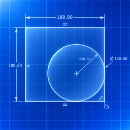
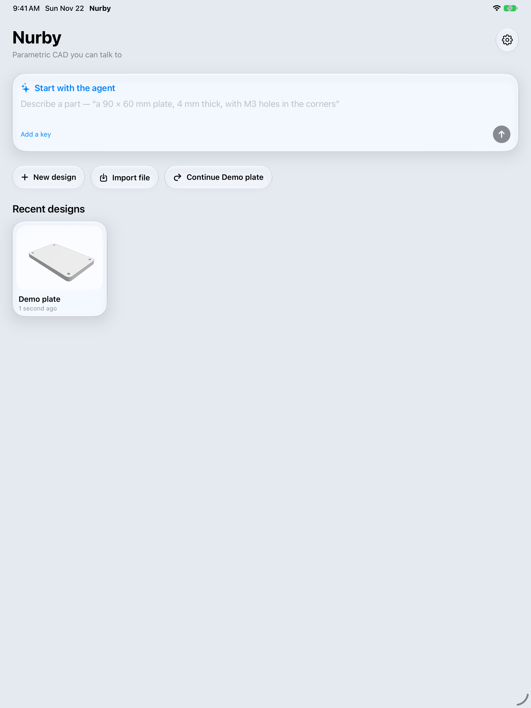
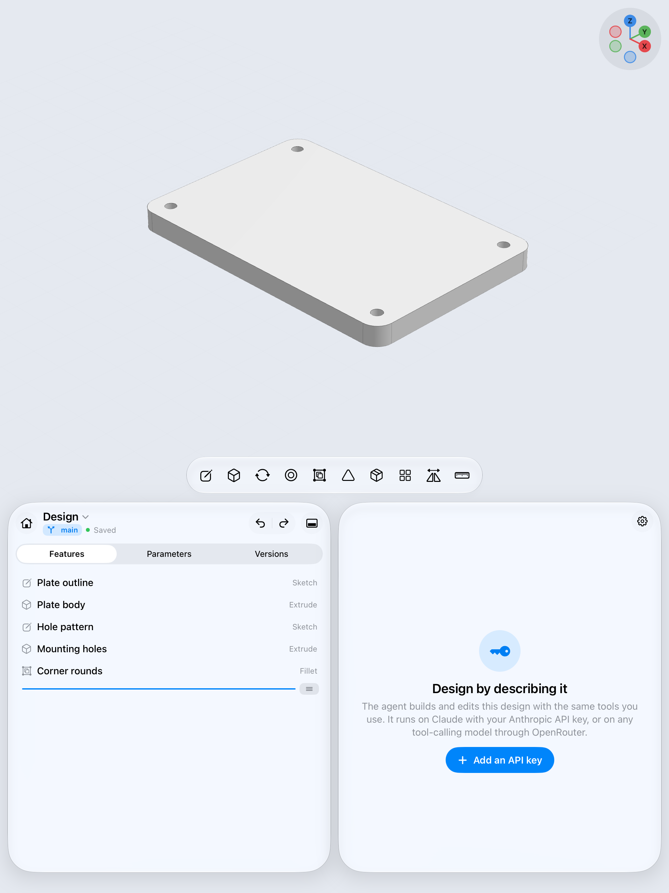

<p align="center"></p>

# Nurby

Parametric CAD for iPad and iPhone: describe a part to an AI agent, watch it build, export real STEP.

<p>
  
  
</p>

Nurby runs the open-source [SolidCraft](https://github.com/tangency-labs/solidcraft) kernel
in-process on the device. The agent is Claude through the [Claude API](https://platform.claude.com)
or any tool-calling model on [OpenRouter](https://openrouter.ai) (bring your own key for either,
stored in the Keychain). It models through SolidCraft's own agent tools, the same commands the touch
UI uses.

- Sketch on a plane or a face with lines, rectangles and circles, dimensions and constraints
- Extrude, revolve, fillet, chamfer and shell, with live previews and editable steps
- Parameters as unit-aware expressions, undo/redo, a rollback bar and versions with branches
- Pen markup and photos as input to the agent
- STEP, STL and 3MF export; designs autosave to the Files app

## Install

The repo has a [`selfstore.yml`](selfstore.yml), so you can add it to [SelfStore](https://github.com/syousif94/SelfStore)
by its URL and install `selfstore/Nurby.ipa` on your iPhone or iPad over the air. iOS 26 or later.

## Layout

| Path | What |
| --- | --- |
| `vendor/solidcraft` | SolidCraft (kernel, engine, MCP tools), a git submodule |
| `crates/nurby-core` | Rust core for the app: a SolidCraft session + its MCP tools + display meshes, via UniFFI |
| `crates/uniffi-bindgen` | Swift binding generator |
| `ios/` | SwiftUI app (XcodeGen): SceneKit viewport, drawer, agent panel, operations bar |
| `scripts/build-xcframework.sh` | Builds `NurbyCore.xcframework` + Swift bindings |
| `CLAUDE.md` | Architecture, conventions and status |

## Build

On a Mac with Xcode (the Rust toolchain and iOS targets come from `rust-toolchain.toml`):

```sh
git clone --recursive https://github.com/syousif94/nurby && cd nurby
cargo test -p nurby-core
scripts/build-xcframework.sh
brew install xcodegen && (cd ios && xcodegen) && open ios/Nurby.xcodeproj
```

The first build compiles all of SolidCraft: expect 10+ minutes, several GB of disk and plenty of memory.

